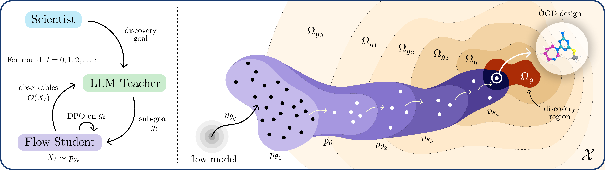

<p align="center">
  <picture>
    <source media="(prefers-color-scheme: dark)" srcset="assets/title-dark.svg">
    
  </picture>
</p>

<p align="center">
  <a href="https://arxiv.org/abs/2610.17246"></a>
  <a href="https://llm-to-flow-distillation.github.io/"></a>
</p>

<p align="center">
  <picture>
    <source media="(prefers-color-scheme: dark)" srcset="assets/authors-outlined-dark.svg">
    
  </picture>
</p>

<p align="center">
  <sup>* Equal contributions, alphabetical order</sup>
</p>

<p align="center">
  <sup>1</sup> ETH Zurich &emsp; <sup>2</sup> ETH AI Center &emsp; <sup>3</sup> Technische Universität Wien<br>
  <sup>4</sup> AITHYRA &emsp; <sup>5</sup> University of Pennsylvania &emsp; <sup>6</sup> University of Oxford
</p>

<!-- Author names and affiliation numbering supplied by the authors, 2026-09-29. -->

---

<br>

<p align="center">
  
</p>

**LLM-to-Flow Distillation** (LFD) iteratively aligns a pretrained scientific generator (the student) towards a natural-language goal 
$g$ with **Direct Preference Optimization (DPO)** on preferences induced by an LLM (the teacher).

Explore the results, subgoals, and LLM traces on the
[project page](https://llm-to-flow-distillation.github.io/).

## Installation

Use Python 3.10 or 3.11 on Linux, with Git installed. Check that `python --version`
reports one of these versions, then copy these commands into your terminal:

```bash
git clone https://github.com/FedericoDiGennaro/LLM-to-Flow-Distillation.git
cd LLM-to-Flow-Distillation
python -m venv .venv
source .venv/bin/activate
python -m pip install -e .
```

These commands download the repository, create an isolated Python environment,
and install the `llm-to-flow` command. The `.` means the current folder; `-e`
keeps the installation connected to this checkout so you can edit the code and
adapt the experiments.
You need GitHub access to clone the repository. Run the commands below from
this folder. In each new terminal or job shell, activate `.venv` again with
`source .venv/bin/activate`.

### API keys

The bundled curricula default to Gemini through Vertex Express. Set the key in
the shell or job environment used to launch the experiment:

```bash
unset GOOGLE_API_KEY
export ADM_LLM_PROVIDER=gemini
export GEMINI_API_KEY="your-vertex-express-api-key"
export HF_TOKEN="your-hugging-face-token"  # Only for downloading gated PepDFM assets.
```

Accept the upstream PepDFM access terms before downloading its assets. API keys
are read from exported environment variables; keep them out of source and
configuration files. The launcher expects `GEMINI_API_KEY` as its only Google
API-key variable, so the block above clears a conflicting `GOOGLE_API_KEY`.

Alternatively, all five `llm-to-flow run` tasks support a LiteLLM gateway's
Responses endpoint:

```bash
export ADM_LLM_PROVIDER=litellm
export LITELLM_API_BASE="https://your-litellm-gateway.example"
export API_KEY_FILE="/absolute/path/to/your/key-file"
unset LITELLM_API_KEY
```

The file can contain one bare key or a `LITELLM_API_KEY="..."` environment
assignment (optionally prefixed with `export`). A `LITELLM_API_BASE` assignment
may accompany the key, but must match the explicitly selected gateway URL.
Other variable names are not used as credentials. The file is read, never
executed, and shell expansion is not performed. Alternatively,
unset `API_KEY_FILE` and export `LITELLM_API_KEY` directly. Google keys are not
used by this route. If your gateway uses different model aliases, map the names
in your task configuration explicitly, for example:

```bash
export LITELLM_MODEL_MAP='{"gemini-3.7-flash":"gemini/gemini-3.7-flash","gemini-3.1-pro-preview":"gemini/gemini-3.1-pro-preview"}'
```

Check those aliases with your gateway administrator. The destination and alias
map are frozen with each run; changing either requires a separate output
directory. Existing call/token limits still apply. Budget calculations use the
configured price estimates, so check these against your gateway's tariffs.
The gateway's returned model name is recorded, but it does not necessarily pin
an immutable upstream revision. Server-side routing/retry policies remain the
gateway administrator's responsibility.

To check transport and structured replies without a GPU or scientific data:

```bash
python -m adm.preferences.provider_smoke \
  --model gemini-3.7-flash --output-dir runs/provider-smoke \
  --calls 3 --maximum-usd 1 \
  --input-usd-per-million 10 --output-usd-per-million 60
```

This prints a plan without reading credentials or making calls. After checking
the route, prices and budget, add `--execute` to allow the listed synthetic
requests. The example rates are conservative estimates to replace with your
gateway's rates, not a pricing quotation. Reusing the same smoke directory
replays saved replies; uncertain attempts are not silently resent. This checks
provider access and parsing, not the GPU runtime or an entire discovery run.

### Peptide runtime

From the source checkout, install the peptide dependencies and download PepDFM:

```bash
python -m pip install -e '.[peptides]'
python -m domains.peptides.fetch_assets --asset-dir /path/to/assets/mog-dfm
```

The peptide extra includes PyTorch 2.6, the sampler, and the predictor
dependencies. Use a CUDA-compatible PyTorch installation on the GPU machine.

### Molecular runtime

FlowMol3 requires a **Linux x86-64 GPU machine** and uses a separate CUDA 12.1
environment. Install [Pixi](https://pixi.sh), then create the environment and
download the model:

```bash
python -m domains.molecules.gsk3b.setup --ltfd-home /path/to/flowmol-runtime
```

The setup command uses the environment in
[domains/molecules/pixi.toml](domains/molecules/pixi.toml) and writes a receipt
that the experiment launcher reads automatically. The same runtime and FlowMol3
assets can be reused by all three molecular tasks.

## Running experiments

Run from a clean source checkout inside an allocated Slurm GPU job. Obtain the
allocation through your cluster before launching; this command does not allocate
GPU resources. Choose a fresh output directory. The launcher prepares the task
inputs, checks the runtime, and starts the adaptive curriculum with one command.

```bash
# Peptides: selective anticancer activity
llm-to-flow run anticancer \
  --assets /path/to/assets/mog-dfm --output-dir runs/anticancer

# Peptides: mammalian cell penetration
llm-to-flow run cell-penetration \
  --assets /path/to/assets/mog-dfm --output-dir runs/cell-penetration

# Molecules: dopamine D2 receptor binding
llm-to-flow run drd2 \
  --runtime-home /path/to/flowmol-runtime --output-dir runs/drd2

# Molecules: GSK3β binding and aqueous solubility
llm-to-flow run gsk3b \
  --runtime-home /path/to/flowmol-runtime --output-dir runs/gsk3b

# Molecules: specified ring motifs for a kinase-focused discovery campaign
llm-to-flow run kinase \
  --runtime-home /path/to/flowmol-runtime --output-dir runs/kinase
```

Each run starts from the pretrained generator. The LLM proposes a reachable
intermediate goal, judges generated candidates, and supplies preferences for a
DPO update. The updated generator is sampled again; its results determine
whether to continue the current goal or advance the curriculum. This repeats
until a stopping condition or configured budget is reached. Candidates, goals,
and updated checkpoints are saved in the output directory.

| Domain | Task guide | Generator |
| --- | --- | --- |
| [Peptides](domains/peptides/README.md) | [Selective anticancer activity](domains/peptides/anticancer/README.md) | PepDFM |
| [Peptides](domains/peptides/README.md) | [Mammalian cell penetration](domains/peptides/cell_penetration/README.md) | PepDFM |
| [Molecules](domains/molecules/README.md) | [Dopamine D2 receptor binding with moderate lipophilicity](domains/molecules/drd2/README.md) | FlowMol3 |
| [Molecules](domains/molecules/README.md) | [GSK3β binding and aqueous solubility](domains/molecules/gsk3b/README.md) | FlowMol3 |
| [Molecules](domains/molecules/README.md) | [Kinase-focused design with specified ring motifs](domains/molecules/kinase/README.md) | FlowMol3 |

Use `llm-to-flow run --help` for optional runtime settings. `--prepare-only`
writes task input files without GPU work or API calls; it does not validate the
GPU runtime, downloaded assets, or model access. Use a separate output directory
for this check: a normal run requires a new or empty directory. Each molecular
task also has a smaller `--smoke` profile; that profile uses the GPU and API.

### LLM traces and output folders

The pipeline creates missing output folders automatically. You do not need to
create trace directories manually. LLM trace folders appear when the first
request is recorded, so `--prepare-only` does not produce LLM traces.

Paths below are relative to the chosen `--output-dir`:

| Task | Raw API attempts | Logical requests and responses |
| --- | --- | --- |
| Anticancer | `campaign/api_attempts/<role>/<request_hash>/` | `campaign/api_artifacts/<role>/<request_hash>/` |
| Cell penetration | `campaign/api_attempts/<role>/<request_hash>/` | `campaign/api_artifacts/<role>/<request_hash>/` |
| DRD2, GSK3β, and kinase design | `api/<role>/api_attempts/<request_hash>/` | `api/<role>/artifacts/<request_hash>/` |

Peptide API preflight records are also stored under `campaign/preflight/`.

Each raw attempt records `attempt_started.json` and, when a response arrives,
`provider_response.json`. Structured parsing produces `parsed_response.json`
or `parse_failure.json`. Logical artifacts use `request.json` and
`response.json`. If a network call fails before a response arrives, its start
record remains. Trace files include prompts, returned output, and usage
metadata; API keys are not included in the transport records. Console output
is separate from these JSON traces.

## Adapting the experiments

The task configurations and prompts are starting points for your experiments:

- Change the goal and its matching domain prompts and validation rules together.
- Choose the teacher models and set their API-call, token, and cost limits in
  the task's `configs/dpo.json`.
- Adjust curriculum limits and generator fine-tuning settings for your task.
- Commit your edits before launching a fresh run, so its inputs remain bound to
  the code you chose.

The LLM builds the curriculum during execution; you do not need to recreate the
paper's sequence of goals or checkpoints. Domain guides link the prompt files,
configuration, and optional baselines. External task evaluation is separate
from the adaptive training loop.
