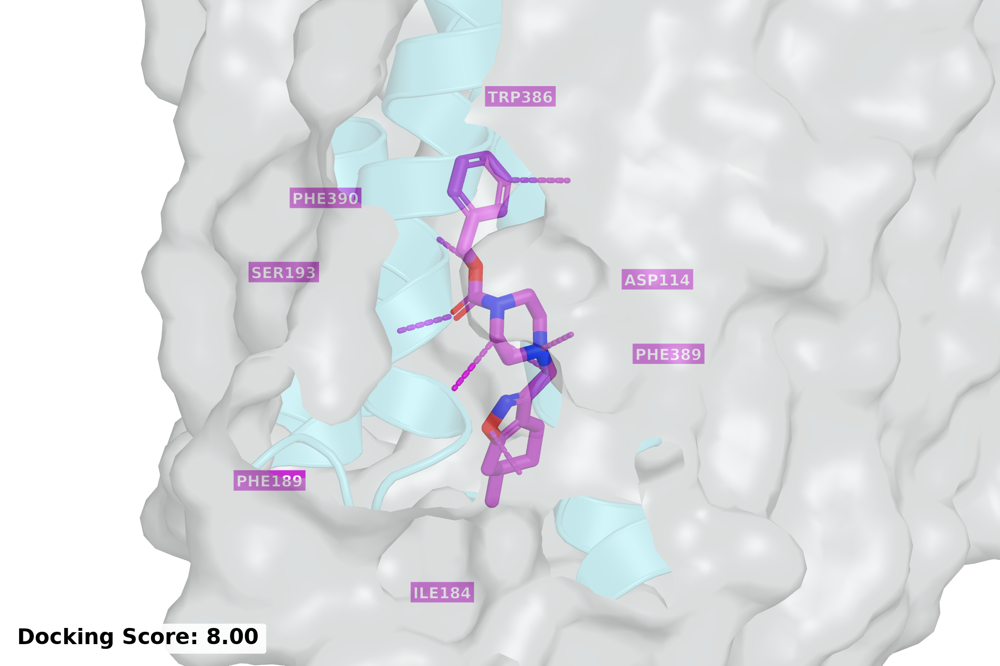

# Dopamine D2 receptor — Goal 3

Appendix D.2.1 of *LLM-to-Flow* defines the final goal:

> Generate promising drug-like small molecules for binding the dopamine D2 receptor, balancing plausible receptor recognition with moderate lipophilicity and chemically viable structures.

The appendix curriculum starts with an aromatic ring and an aliphatic nitrogen
(`g0`, five updates), adds a second aromatic ring (`g1`, one update), and then
trains on the final goal (`F`, three updates). The curriculum profile uses
flow-DPO with learning rate `5e-6`, beta `1`, batch size `8`, and `128` optimizer
steps per update. Advancement requires a stable positive fraction of at least
`0.30` and a gain of at least `0.10` from goal adoption. Working cohorts contain
128 attempts; independent development cohorts contain 256 attempts.

The archived checkpoint is `drugs-ltfd-c3h3g2s-07g-03`, round 3, following the
`c3 → c3h3 → c3h3g2-08 → c3h3g2s-07 → c3h3g2s-07g-03` lineage. Its reported
computational scores are GNINA CNNaffinity **6.541524**, Vina **−8.479160**, and
rDock **−9.886278** against the D2 receptor (PDB **6CM4**). RDKit validity is
**251/256**, and PoseBusters `mol_fast` validity is **229/256**. The result
manifest also includes the intermediate checkpoints and four baseline methods.

The baseline reward is the TDC/Olivecrona DRD2 probability from folded FCFP6
count fingerprints, multiplied by an indicator for RDKit MolLogP in `[1, 3]`.
DPO uses a median split of scored rewards. FlowGRPO uses stochastic ODE-to-SDE
trajectories; reward guidance fits a time-conditioned graph predictor while
keeping the generator frozen. Set up the isolated reward runtime with:

```bash
python -m domains.molecules.drd2.setup_reward \
  --python domains/molecules/.pixi/envs/default/bin/python \
  --asset-root /path/to/drd2-reward
```

## Setup and execution

Complete the root [installation and API setup](../../../README.md#installation).
From a clean source checkout, install the pinned molecular runtime and FlowMol3:

```bash
python -m domains.molecules.drd2.setup --ltfd-home /path/to/flowmol-runtime
```

Inside a Slurm GPU allocation, with the chosen LLM provider configured,
start a fresh campaign:

```bash
llm-to-flow run drd2 \
  --runtime-home /path/to/flowmol-runtime \
  --output-dir /path/to/runs/drd2
```

Add `--prepare-only` for input preparation without GPU work or API calls, or
`--smoke` for the smaller integration profile. The module reads the setup
receipt and binds the campaign to its configuration and committed source.
Setup uses [../pixi.toml](../pixi.toml). Generated samples, model checkpoints,
candidate cards, two-pass judgments, controller/auditor traces, and accounting
records are saved under the output root. Runtime assets and run outputs should
be stored outside the source checkout.

Validate a completed campaign with:

```bash
python -m domains.molecules.drd2.validate \
  --config domains/molecules/drd2/configs/dpo.json \
  --output-root /path/to/runs/drd2
```

## Files and configuration

This directory has the same relative file paths as [../gsk3b](../gsk3b).

- [configs/dpo.json](configs/dpo.json): final goal, teacher models, budgets,
  working/development cohorts, curriculum gates, and flow-DPO settings.
- [configs/smoke.json](configs/smoke.json): bounded integration profile.
- [teacher.py](teacher.py) and [cards.py](cards.py): task-local prompts and
  candidate evidence. Cards include molecular identity, RDKit descriptors
  (including Crippen LogP), functional groups, and geometry diagnostics.
- [oracle.py](oracle.py), [reward.py](reward.py), and [setup_reward.py](setup_reward.py):
  the separate scalar reward used by the comparison methods.
- [baselines/](baselines/): DPO, DiffusionNFT, FlowGRPO, reward guidance, and
  an optional reward-tilting implementation. [table.json](baselines/table.json)
  records archived run identifiers, result summaries, and source/checkpoint hashes.

The teacher labels candidates POSITIVE, NEGATIVE, or ABSTAIN independently in
two passes; only stable positives and negatives enter training pairs. Docking,
scalar reward predictions, and experimental outcomes are hidden from the
teacher. Evaluation is a separate post-generation workflow.

For a reward baseline, choose the corresponding JSON profile in `baselines/`,
create its run receipt with `python -m domains.molecules.drd2.prepare --help`,
then use `python -m domains.molecules.drd2.baselines.METHOD --help` for the
explicit asset, configuration, output, and authorization arguments (`METHOD`
is `dpo`, `nft`, `grpo`, `guidance`, or `tilt`). Pass the explicit FlowMol asset
paths and interpreter recorded in the setup receipt. `--tdc-python` selects the reward-scoring interpreter;
`--oracle` selects the model asset or verifier file from its reward setup receipt.

The profiles launch new adaptive campaigns. The archived records in
`baselines/table.json` identify the checkpoints and cohorts used for the
reported results; model weights and complete run artifacts remain external.
