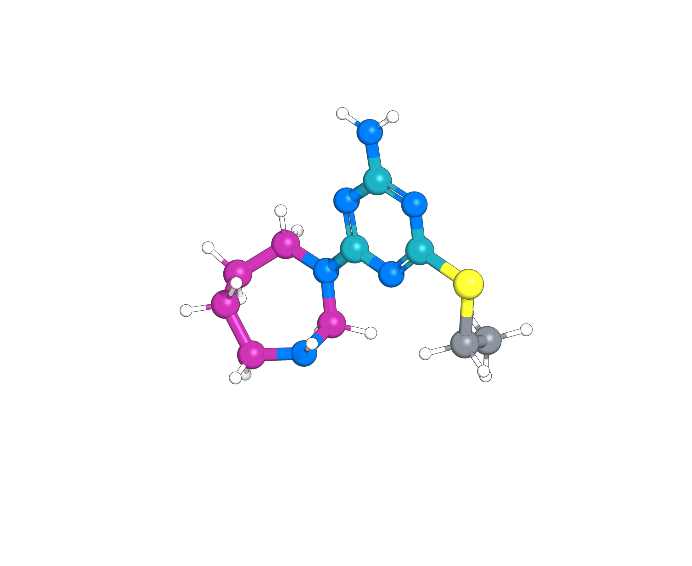

# Seed for a kinase campaign — Goal 5

Appendix D.2.3 of *LLM-to-Flow* defines the final goal:

> Generate neutral, connected small molecules for a kinase-focused discovery campaign that contain a six-membered aza-aromatic ring bearing a free primary amino group on a ring carbon adjacent to a pyridine-like ring nitrogen, and a distinct fully saturated ring containing a free secondary amine. The saturated amine-containing ring need not be carbon-linked to the aza-aromatic ring.

The appendix curriculum progresses from a neutral, connected molecule with an
aromatic heterocycle (`g0`), to a six-membered aza-aromatic ring (`g1`), and then
to that ring plus a free primary or secondary amine (`g2`). The reported run
uses one update on each of the first two goals and four on `g2`.

Flow-DPO uses learning rate `5e-6`, beta `1`, batch size `8`, **150 optimizer
steps**, and at most **1,024 preference pairs** per update. Working cohorts have
128 attempts and independent development cohorts have 512. A goal passes when
its stable positive fraction is **strictly greater than 0.20**; no improvement
delta is required. The fresh campaign profile allows at most 20 rounds.

The archived run is `kinase-ltfd-linkrelaxed-p020-x20-05`, round 6. Its child
development cohort contains **one final-goal hit in 512 attempts**: generation
sample **154**, blinded as **item_151**, shown above. The result manifest binds
the checkpoint, candidate SDF, judgments, and six-round curriculum by hashes.

The comparison reward is a binary RDKit graph check of the full requested
motif. It imposes no carbon-linkage requirement, saturated-ring size bound,
or conformer geometry gate. The DPO, DiffusionNFT, FlowGRPO, and reward-guidance
comparison cohorts each have zero positives among 512 candidates; guidance
uses the FlowGRPO cohort. These methods stop before adaptation when the reward
cannot supply their required preference classes or variation.

No learned reward asset is needed. Validate and receipt the verifier using a
Python environment with RDKit:

```bash
python -m domains.molecules.kinase.setup_reward --asset-root /path/to/kinase-reward
```

## Setup and execution

Complete the root [installation and API setup](../../../README.md#installation).
From a clean source checkout, install the pinned molecular runtime and FlowMol3:

```bash
python -m domains.molecules.kinase.setup --ltfd-home /path/to/flowmol-runtime
```

Inside a Slurm GPU allocation, with the chosen LLM provider configured,
start a fresh campaign:

```bash
llm-to-flow run kinase \
  --runtime-home /path/to/flowmol-runtime \
  --output-dir /path/to/runs/kinase
```

Add `--prepare-only` for input preparation without GPU work or API calls, or
`--smoke` for the smaller integration profile. The module reads the setup
receipt and binds the campaign to its configuration and committed source.
Setup uses [../pixi.toml](../pixi.toml). Generated samples, model checkpoints,
candidate cards, two-pass judgments, controller/auditor traces, and accounting
records are saved under the output root. Runtime assets and run outputs should
be stored outside the source checkout.

Validate a completed campaign with:

```bash
python -m domains.molecules.kinase.validate \
  --config domains/molecules/kinase/configs/dpo.json \
  --output-root /path/to/runs/kinase
```

## Files and configuration

This directory has the same relative file paths as [../gsk3b](../gsk3b).

- [configs/dpo.json](configs/dpo.json): final goal, teacher models, budgets,
  working/development cohorts, curriculum gates, and flow-DPO settings.
- [configs/smoke.json](configs/smoke.json): bounded integration profile.
- [teacher.py](teacher.py) and [cards.py](cards.py): task-local prompts and
  candidate evidence. Cards include molecular identity, RDKit descriptors
  (including Crippen LogP), functional groups, and geometry diagnostics.
- [oracle.py](oracle.py), [reward.py](reward.py), and [setup_reward.py](setup_reward.py):
  the separate scalar reward used by the comparison methods.
- [baselines/](baselines/): DPO, DiffusionNFT, FlowGRPO, reward guidance, and
  an optional reward-tilting implementation. [table.json](baselines/table.json)
  records archived run identifiers, result summaries, and source/checkpoint hashes.

The teacher labels candidates POSITIVE, NEGATIVE, or ABSTAIN independently in
two passes; only stable positives and negatives enter training pairs. Docking,
scalar reward predictions, and experimental outcomes are hidden from the
teacher. Evaluation is a separate post-generation workflow.

For a reward baseline, choose the corresponding JSON profile in `baselines/`,
create its run receipt with `python -m domains.molecules.kinase.prepare --help`,
then use `python -m domains.molecules.kinase.baselines.METHOD --help` for the
explicit asset, configuration, output, and authorization arguments (`METHOD`
is `dpo`, `nft`, `grpo`, `guidance`, or `tilt`). Pass the explicit FlowMol asset
paths and interpreter recorded in the setup receipt. `--tdc-python` selects the reward-scoring interpreter;
`--oracle` selects the model asset or verifier file from its reward setup receipt.

The profiles launch new adaptive campaigns. The archived records in
`baselines/table.json` identify the checkpoints and cohorts used for the
reported results; model weights and complete run artifacts remain external.
